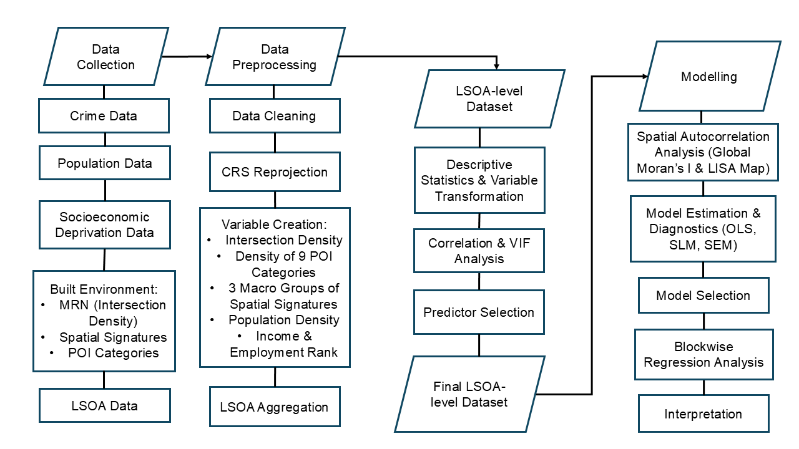
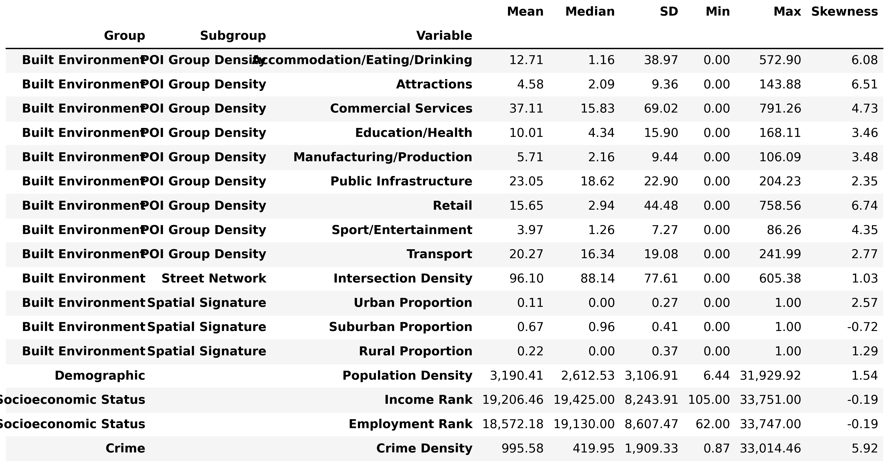
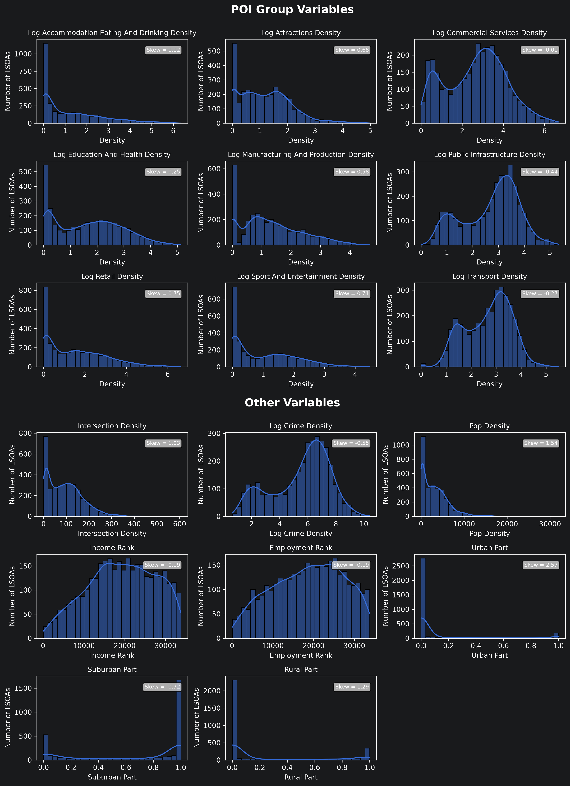
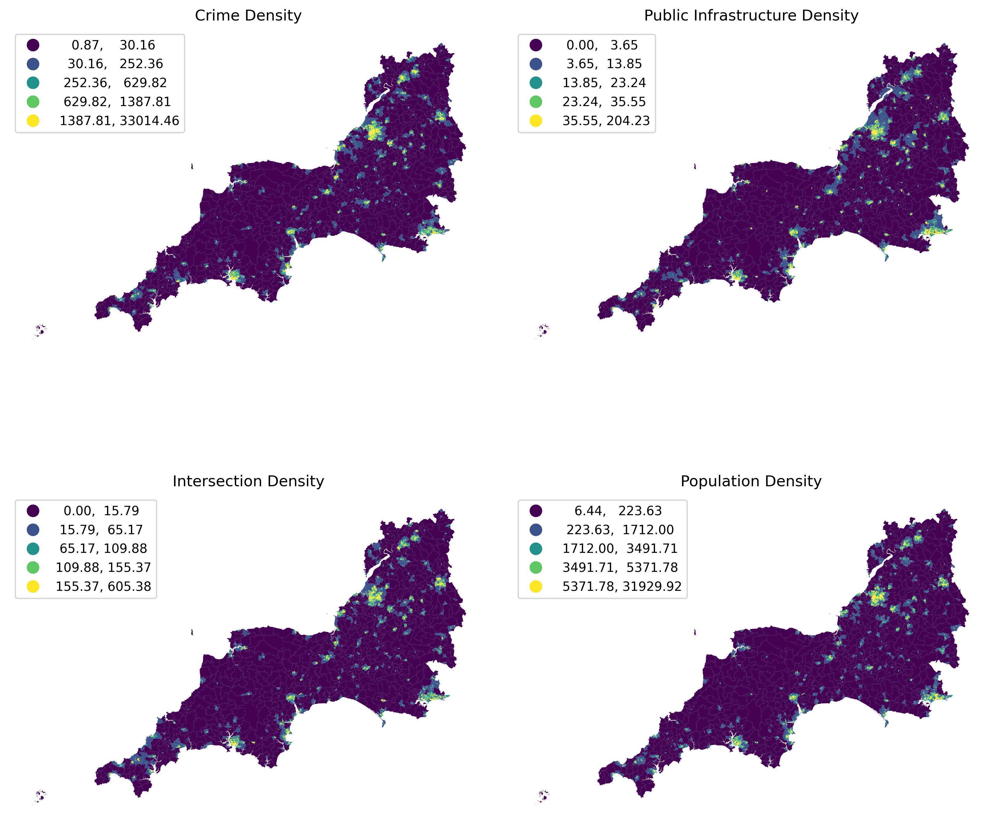
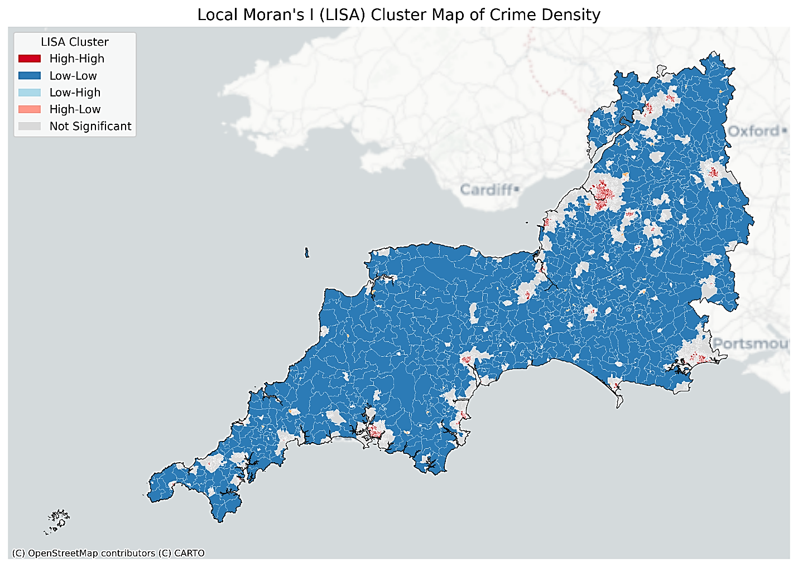
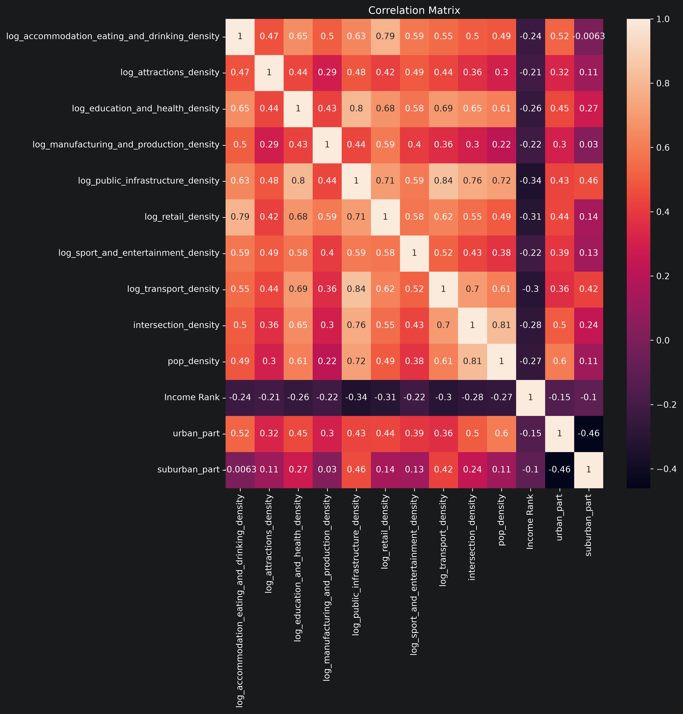
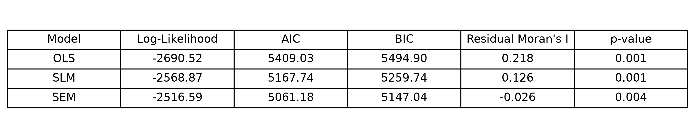
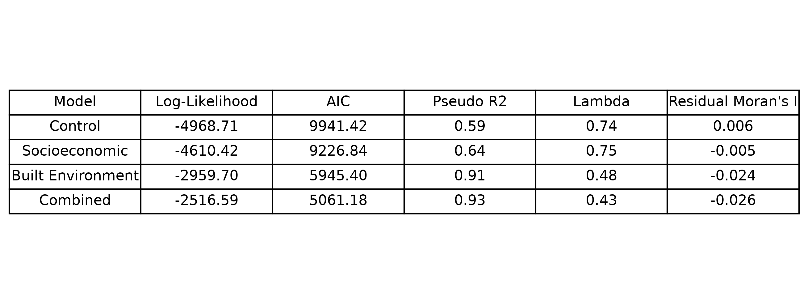

# A Master's Dissertation Project
### Geography of Crime in South West England: Built-Environment and Socioeconomic Associations in A Spatial Regression Framework

A lot of topics actually came into my mind during my MSc coursework when thinking about what I should do for my dissertation. But then when I was introduced about spatial dependency last year in one of my courses, I couldn't help but think that it's an interesting topic, and I was intrigued to investigate it more. So, here it is; a project examined the geographical distribution of recorded crime across South West England and its associations with built-environment and socioeconomic characteristics.

**Research area:** South West England, UK  
**Spatial unit:** Lower Layer Super Output Areas (LSOAs)  
**Study period:** 2025  
**Primary tools:** Python, GeoPandas, PySAL, Pandas, Matplotlib

---

## Project Overview

As we may know, crime is not distributed evenly across geographical areas. Differences in the built environment, land use, accessibility and socioeconomic conditions may be associated with variations in crime patterns. This project investigates the geography of recorded crime across South West England, exploring how built-environment characteristics and socioeconomic conditions are associated with crime density. Using spatial data integration, exploratory spatial analysis and spatial regression techniques, the research examines geographical patterns and accounts for spatial dependence between neighbouring areas.

The analysis itself focuses on understanding these spatial associations rather than establishing causal effects study.

## Research Questions

Here are the research questions:

1. What spatial patterns and associations are evident among crime density, built-environment characteristics, and socioeconomic deprivation across LSOAs in South West England?
2. To what extent do built-environment characteristics and socioeconomic deprivation included in this study contribute to explaining variation in crime density across LSOAs in South West England?

## Study Area

The study covers South West England, using Lower Layer Super Output Areas (LSOAs) as the unit of spatial analysis.

The initial study area contained 3,407 LSOAs. An area (the Isles of Scilly) was excluded from the modelling dataset because of its incompatibility with the Queen contiguity spatial weights specification, resulting in final 3,406 LSOAs as modelling units.

<h4 align="center">Figure 1 - Study Area Map</h4>

## Data Sources and Variables

The analysis integrates crime, built-environment and socioeconomic datasets.

| Data category | Variables / indicators | Purpose |
|---|---|---|
| Recorded crime | Police-recorded crime data (2025) | Dependent variable |
| Built environment | Points of Interest (POI) categories | Represent local facilities and activities |
| Built environment | Intersection Density derived from OS MRN data | Represent road network characteristics |
| Built environment | ONS Spatial Signatures | Represent broader urban morphology characteristics |
| Socioeconomic conditions | IMD 2025 Income Rank | Represent income-related deprivation |
| Population characteristics | Population density | Control variable |

The selection of the three built environment characteristics was informed by a multidimensional conceptualization of built-environment through ‘density’, ‘diversity’, and ‘design’, which was proposed by Cervero and Kockelman (1997). As for the socioeconomic conditions, there are other several indicators but dropped due to some considerations.

**_Dependent Variable (Crime Density)_**

The South West England 2025 crime dataset was collected as a monthly dataset, then merged to obtain an annual dataset which consists of 1.46 million records before aggregation and processing. The dependent variable was constructed from this crime dataset as crime density, which is counted crime incidents per square kilometer in one LSOA. 

**_Independent Variable_**

A. Built environment characteristics:

1. POIs

The Points of Interest (POIs) dataset was collected from Digimap, an online map and data delivery service that is operated by EDINA at University of Edinburgh. The POIs was organised into nine categories as its initial construction to represent different types of facilities and activities across the study area. A few datasets of POIs had to be merged to cover South West England area then filtered to ensure the consistency of the geometrical boundaries; more than 391k data points were obtained.

2. Intersection Density

This data was generated from OS Multi-modal Routing Network (MRN) data, also collected from Digimap. OS MRN data consists of a fully connected routable network which is described by Transport Node, a point spatial object that constructs the Transport Network. Since this study is focused on neighborhood area, the nodes were filtered based on that, then the nodes which are connected to three or more nodes were selected as street junction/intersection.

3. Spatial Signatures

A spatial data called ‘Spatial Signatures’ that combines urban form and function context was incorporated in this research, derived by Fleischmann & Arribas-Bel, 2021. Spatial Signatures reflect distinction between three broader groups that represent countryside, suburban low density development, and dense city centres, which then was adopted in this study and referred to as rural, suburban, and urban areas.

B. Socioeconomic Deprivation

Income Rank and Employment Rank were initially considered as socioeconomic deprivation indicators at LSOA level. However, Employment Rank was subsequently excluded during feature selection, which will be explained in later section. Income Deprivation Domain, such as Income Rank and Employment Rank, captures the distribution of residents experiencing deprivation related to low income, which can be associated to weaker social control thus exposed to higher risk of crime. The data were collected from 2025 Indices of Deprivation.

**_Control Variable (Population Density)_**

A control variable is a variable that is introduced to the model to account for potential confounding influences when estimating relationships between predictors and the response variable (Memon et al., 2024), that is population density in this study.

## Analytical Workflow

The project followed a series of complex and intricate data execution, which then summarised as data processing, spatial analysis and modelling stages.

<h4 align="center">Figure 2 - Analytical Workflow</h4>

### Data Preprocessing

For each dataset, the preprocessing was quite similar. The initial check consists of data cleaning; checking duplicates, null values, and data consistency, then merging datasets per variable. Afterwards, aggregated each dataset to LSOA boundaries, then integrated them into one final dataset.

### Exploratory Analysis

Exploratory analysis was conducted to understand the spatial and statistical distribution of each variable across the study area.

#### Descriptive Statistics

Here is the descriptive statistics of the variables:

<h4 align="center">Figure 3 - Descriptive Statistics</h4>

Based on the descriptive statistics, most of the variables have high positive skewness. In order to regulate the highly irregular distribution of some variables, a variable transformation is carried out with log transformation, log(1+x), denote by log1p.

Here is the transformation result.

<h4 align="center">Figure 4 - POI group variables & the crime density variable before and after transformation</h4>

#### Spatial Distribution

The spatial distribution of several variables is shown to identify potential patterns of geographical correspondence, which the four variables exhibited widely similar spatial distributions.

<h4 align="center">Figure 5 - Spatial Distribution of Crime Density, Public Infrastructure POI Density, Intersection Density, and Population Density across South West England</h4>

Then the spatial autocorrelation of the dependent variable is visualized with LISA Map.

<h4 align="center">Figure 6 - LISA Map of Crime Density</h4>

### Feature Selection

A multicollinearity test was then carried out with Pearson correlation heatmap.

<h4 align="center">Figure 7 - Multicollinearity Estimation of selected predictors</h4>

### Spatial Regression Modelling

The modelling stage examined associations between crime density and the selected explanatory variables.

The analysis included:

- Ordinary Least Squares (OLS) regression as a baseline model.
- Spatial Error Model (SEM) to account for spatial dependence in the error structure.
- Queen contiguity spatial weights to represent neighbourhood relationships between LSOAs.
- Model comparison using goodness-of-fit and information criteria.
- Residual spatial autocorrelation assessment.

The modelling process also considered multicollinearity when selecting explanatory variables. For example, the Employment Deprivation Rank was excluded because of its strong correlation with the Income Deprivation Rank.

<h4 align="center">Figure 8 - Comparison between Regression Models</h4>

### Model Diagnostics

Model diagnostics were used to assess the extent to which spatial dependence remained after regression modelling.

Moran's I was used to examine spatial autocorrelation in the model residuals, alongside comparisons of model performance.

<h4 align="center">Figure 9 - Comparison between Blockwise Models</h4>

## Key Findings

The analysis identified substantial geographical variation in recorded crime density across South West England.

The built-environment analysis showed that different types of facilities and infrastructure were distributed unevenly across the study area. Commercial Services had the highest average density among the selected POI categories.

The spatial regression analysis highlighted the importance of accounting for spatial dependence when examining the relationships between crime density and its potential correlates.

**Selected model results:**

| Evaluation metric | Result |
|---|---:|
| OLS residual Moran's I | [Insert final value] |
| SEM residual Moran's I | [Insert final value] |
| SEM lambda | [Insert final value] |
| SEM AIC | [Insert final value] |

[Insert regression results visualisation here]

*Note: Results describe statistical associations within the study area and should not be interpreted as evidence of causation.*

## 7. Tools and Technologies

| Category | Tools |
|---|---|
| Programming | Python |
| Data manipulation | Pandas, NumPy |
| Geospatial processing | GeoPandas |
| Spatial statistics | PySAL |
| Data visualisation | Matplotlib |
| Spatial analysis | Spatial weights, Moran's I, spatial regression |

## 8. Limitations

